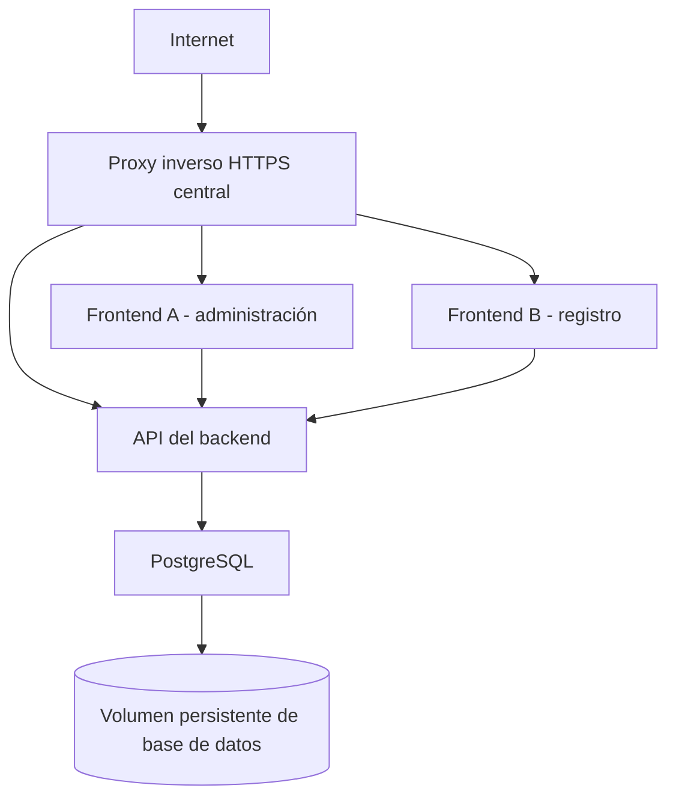

# Despliegue de producción en Proxmox

Instrucciones operativas para desplegar los tres repositorios independientes de GitHub en una máquina virtual Docker alojada en Proxmox. Sustituye todas las URL y direcciones de ejemplo antes de usar esta guía. Mantén el proyecto Compose de cada repositorio en su propio directorio; no los combines en un archivo Compose raíz.

## Arquitectura



Frontend A, Frontend B y el backend son repositorios independientes y proyectos Compose separados. Cada proyecto frontend contiene únicamente su propio servicio Nginx. El proyecto backend contiene la API NestJS, un servicio de migración Prisma de una sola ejecución y PostgreSQL. Solo el backend se comunica con PostgreSQL. Los navegadores de los usuarios llaman a la URL HTTPS pública del backend; no pueden usar un nombre de servicio interno de Docker.

## Preparación de la máquina virtual en Proxmox

Usa una máquina virtual dedicada con Debian 12 o Ubuntu Server 24.04 LTS para ejecutar Docker. Se recomienda una VM en lugar de ejecutar Docker dentro de un LXC porque ofrece un kernel aislado y convencional, y evita complicaciones de anidamiento y permisos de LXC.

Para una instalación pequeña, asigna al menos 2 vCPU, 4 GB de RAM y 40 GB de almacenamiento SSD. Usa 4 vCPU, 8 GB de RAM y más almacenamiento si aumentan los archivos subidos o el volumen de la base de datos. Supervisa el uso de PostgreSQL, los archivos subidos y las imágenes Docker; dimensiona el disco virtual considerando las copias de seguridad y el crecimiento.

Asigna a la VM una IP estable o una reserva DHCP. Crea registros DNS como `forms.example.com`, `admin.example.com` y `api.example.com` que apunten a la dirección pública del proxy inverso. Redirige únicamente HTTPS (TCP 443) y, si se necesita para emitir certificados, HTTP (TCP 80) hacia el proxy inverso. No redirijas el puerto PostgreSQL 5432.

Configura el firewall de Proxmox y el firewall de la VM. Permite SSH solo desde las redes de administración y el tráfico web público únicamente hacia el proxy inverso. Permite que solo la IP privada del proxy acceda a los puertos de host `8081` y `8082` de los frontends y `3008` del backend. No permitas conexiones entrantes al puerto TCP 5432. Habilita DNS y HTTPS salientes, así como el acceso a los repositorios de paquetes, para actualizar el sistema y descargar imágenes.

Realiza copias de seguridad de la VM y de los volúmenes de datos. Un volumen Docker con nombre persiste al reemplazar contenedores, pero no sustituye una copia de seguridad.

## Instalar Docker Engine y Compose

Ejecuta estos comandos dentro de la VM Debian/Ubuntu. Usan el repositorio apt oficial de Docker e instalan el complemento Compose:

```sh
sudo apt-get update
sudo apt-get install -y ca-certificates curl
sudo install -m 0755 -d /etc/apt/keyrings
sudo curl -fsSL https://download.docker.com/linux/$(. /etc/os-release && echo "$ID")/gpg -o /etc/apt/keyrings/docker.asc
sudo chmod a+r /etc/apt/keyrings/docker.asc
echo "deb [arch=$(dpkg --print-architecture) signed-by=/etc/apt/keyrings/docker.asc] https://download.docker.com/linux/$(. /etc/os-release && echo "$ID") $(. /etc/os-release && echo "$VERSION_CODENAME") stable" | sudo tee /etc/apt/sources.list.d/docker.list > /dev/null
sudo apt-get update
sudo apt-get install -y docker-ce docker-ce-cli containerd.io docker-buildx-plugin docker-compose-plugin
sudo systemctl enable --now docker
sudo docker run --rm hello-world
docker compose version
```

Usa `sudo docker ...`, salvo que el administrador configure deliberadamente el acceso mediante el grupo `docker`. Pertenecer al grupo `docker` otorga privilegios equivalentes a los de root.

## Clonar los repositorios

Crea un directorio para cada repositorio y sustituye los marcadores por las URL reales de GitHub:

```sh
sudo mkdir -p /opt/senescyt
sudo chown "$USER":"$USER" /opt/senescyt
cd /opt/senescyt
git clone <FRONTEND_A_REPOSITORY_URL> frontend-a
git clone <FRONTEND_B_REPOSITORY_URL> frontend-b
git clone <BACKEND_REPOSITORY_URL> backend
```

Cada directorio tiene su propio `Dockerfile`, `docker-compose.yml`, `.dockerignore`, `.gitignore`, `.env.example` y README. Ejecuta los comandos Compose desde el directorio del repositorio correspondiente.

## Configurar el entorno de producción

Crea archivos de entorno privados. No los subas a GitHub ni los incluyas en copias de seguridad sin cifrar:

```sh
cd /opt/senescyt/backend
cp .env.example .env
openssl rand -hex 32
nano .env
```

Usa la cadena hexadecimal aleatoria generada como valor de `POSTGRES_PASSWORD` y coloca la misma contraseña en `DATABASE_URL`. El formato hexadecimal evita problemas de codificación de URL. En `DATABASE_URL`, usa el nombre del servicio PostgreSQL `postgres`, no `localhost`. Configura `CORS_ORIGINS` con los orígenes exactos del navegador, por ejemplo, `https://admin.example.com,https://forms.example.com`; configura `PUBLIC_BASE_URL=https://api.example.com`. Mantén `SWAGGER_ENABLED=false`. Establece los permisos del archivo con `chmod 600 .env`.

Configura cada frontend por separado:

```sh
cd /opt/senescyt/frontend-a
cp .env.example .env
nano .env

cd /opt/senescyt/frontend-b
cp .env.example .env
nano .env
```

Configura `API_URL` en ambos frontends con el valor `https://api.example.com/api`. Angular incorpora esta URL pública a la imagen durante la compilación, por lo que debes volver a crearla si cambia. Los puertos de host predeterminados son `8081` y `8082`; cambia `FRONTEND_HOST_PORT` si es necesario. Compose publica el backend en el puerto `3008` de forma predeterminada; usa `BACKEND_HOST_PORT` para cambiarlo. Mantén `PORT` del contenedor backend en `3008`, salvo que también ajustes el mapeo de puertos y la comprobación de estado.

## Desplegar el backend

Confirma que `.env` contenga valores reales y que el usuario, la base de datos y la contraseña de PostgreSQL coincidan con `DATABASE_URL`. Luego ejecuta:

```sh
cd /opt/senescyt/backend
docker compose build
docker compose up -d
docker compose ps
docker compose logs --tail=100 postgres migrate backend
```

Compose espera a que PostgreSQL supere la comprobación `pg_isready`, ejecuta `prisma migrate deploy` en el servicio de migración y luego inicia la API. Comprueba `http://<VM_PRIVATE_IP>:3008/api/health` desde una red privada autorizada o usa la URL del proxy inverso. Los datos de PostgreSQL se guardan en el volumen `senescyt-postgres-data`; los archivos subidos, en `senescyt-uploads`.

El sistema de migraciones aplica los archivos versionados en `prisma/migrations`. No ejecutes `prisma migrate dev` en producción. Los datos semilla no se cargan automáticamente. En el primer despliegue sobre una base nueva y vacía, inicializa los catálogos requeridos antes de permitir el acceso de usuarios:

```sh
docker compose run --rm migrate npm run db:seed
docker compose logs --tail=100 backend
```

La carga semilla actual actualiza o crea entradas de catálogo y elimina los identificadores que no figuran en sus datos fuente. Antes de ejecutarla sobre una base existente, haz una copia de seguridad y revisa los cambios; las referencias de claves foráneas pueden impedir la eliminación de catálogos obsoletos. No la ejecutes automáticamente al reiniciar.

## Desplegar cada frontend

Despliega cada repositorio por separado:

```sh
cd /opt/senescyt/frontend-a
docker compose build
docker compose up -d
docker compose ps
docker compose logs --tail=100 frontend

cd /opt/senescyt/frontend-b
docker compose build
docker compose up -d
docker compose ps
docker compose logs --tail=100 frontend
```

De forma predeterminada, Frontend A escucha en el puerto `8081` de la VM y Frontend B en el `8082`. Configura el proxy inverso central para dirigir los dos dominios HTTPS a esos puertos y `api.example.com` al puerto `3008`. Conserva la ruta `/api` al reenviar solicitudes a la API. Incluye ambos orígenes exactos de los frontends en `CORS_ORIGINS` del backend.

La API actual no tiene controles de autenticación ni autorización. No expongas los endpoints de registros estudiantiles a Internet hasta implementar una política de autenticación y autorización, o limita el acceso a una VPN o red privada de confianza. CORS no controla el acceso de clientes que no son navegadores. Coordina esta restricción de seguridad con el responsable del sistema antes de habilitar el DNS público o el proxy.

## Proxy inverso y HTTPS

Usa una única instalación de Nginx, Traefik o Nginx Proxy Manager, administrada de forma central en la VM Docker o en una VM de proxy separada. No la acoples a estos tres repositorios. Termina HTTPS allí, automatiza la renovación de certificados y reenvía las solicitudes a la dirección privada de la VM y a los puertos `8081`, `8082` y `3008`. Limita el firewall de la VM para que solo el proxy pueda acceder a esos puertos. PostgreSQL no publica ningún puerto en el host y no debe añadirse a las rutas del proxy.

Se recomiendan los nombres DNS `admin.example.com`, `forms.example.com` y `api.example.com`. Configura `API_URL` en el `.env` de cada frontend como `https://api.example.com/api` y `PUBLIC_BASE_URL` del backend como `https://api.example.com`. Comprueba que los límites de tamaño y tiempo del proxy permitan las cargas legítimas de documentos de la aplicación.

## Desplegar actualizaciones

Despliega cada repositorio por separado:

```sh
cd /opt/senescyt/backend
git pull
docker compose build
docker compose up -d
docker compose ps
```

El servicio de migración ejecuta las migraciones Prisma versionadas antes de iniciar la API. Revisa cada migración para detectar riesgos de pérdida de datos o interrupciones y haz una copia de seguridad antes de aplicarla. Actualiza cada frontend con la misma secuencia `git pull`, `docker compose build` y `docker compose up -d`, desde su propio directorio. Si cambia `API_URL`, vuelve a crear la imagen de ese frontend.

## Diagnóstico y operaciones habituales

Ejecuta los comandos Compose desde el directorio del repositorio afectado:

```sh
docker compose ps
docker compose logs -f --tail=200
docker compose logs -f backend
docker compose restart backend
docker compose exec postgres sh -c 'pg_isready -U "$POSTGRES_USER" -d "$POSTGRES_DB"'
docker compose exec backend node -e "fetch('http://127.0.0.1:3008/api/health').then(async r => { console.log(r.status, await r.text()); process.exit(r.ok ? 0 : 1) })"
docker network ls
docker network inspect <nombre-red-compose>
docker system df
df -h
docker compose build --no-cache
```

Para comprobar la conexión a la base de datos, revisa los registros del backend y de las migraciones o ejecuta `docker compose run --rm migrate npm run db:check`. La solicitud de estado de la API debe devolver HTTP 200. Si no ocurre, revisa el estado de PostgreSQL, el resultado de la migración, el nombre de host y las credenciales de `DATABASE_URL`, los registros del backend, el firewall del equipo anfitrión y el servidor de destino del proxy inverso.

Para limpiar recursos de forma segura, `docker compose down` elimina los contenedores y la red del proyecto, pero conserva los volúmenes con nombre. `docker image prune` elimina imágenes sin etiqueta que no estén en uso. Revisa `docker system df` antes de eliminar recursos. No ejecutes `docker compose down -v`, `docker volume prune` ni comandos generales de limpieza del sistema a menos que exista una copia de seguridad verificada y sea intencional eliminar esos datos.

## Resumen de puertos, volúmenes y dominios

| Componente | Puerto del host de la VM | Observaciones |
| --- | ---: | --- |
| Frontend A | 8081 | Restringido al proxy inverso. |
| Frontend B | 8082 | Restringido al proxy inverso. |
| API del backend | 3008 | Restringida al proxy inverso o a una red privada. |
| PostgreSQL | Ninguno | Solo en la red Compose interna del backend; sin acceso desde Internet. |

Volúmenes persistentes: `senescyt-postgres-data` para PostgreSQL y `senescyt-uploads` para los archivos subidos. Dominios públicos: `admin.example.com`, `forms.example.com` y `api.example.com`; sustitúyelos por nombres controlados por la organización.